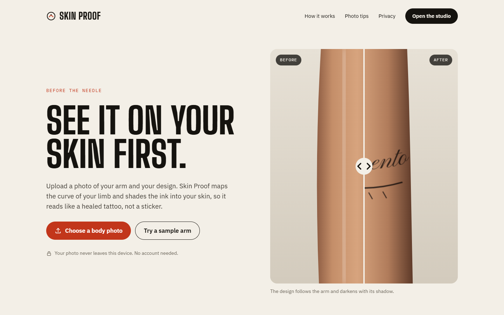
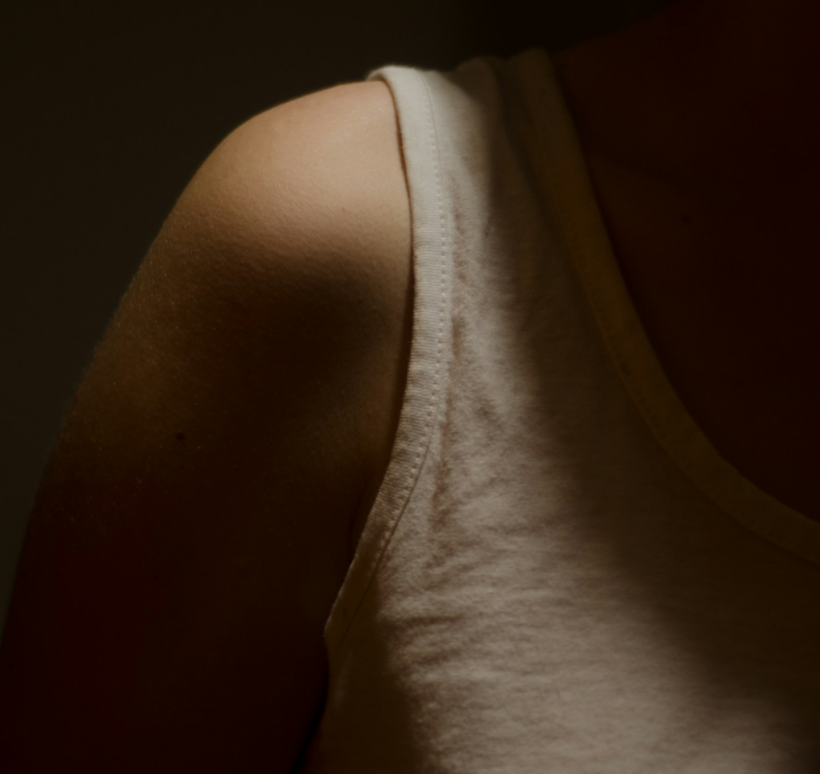
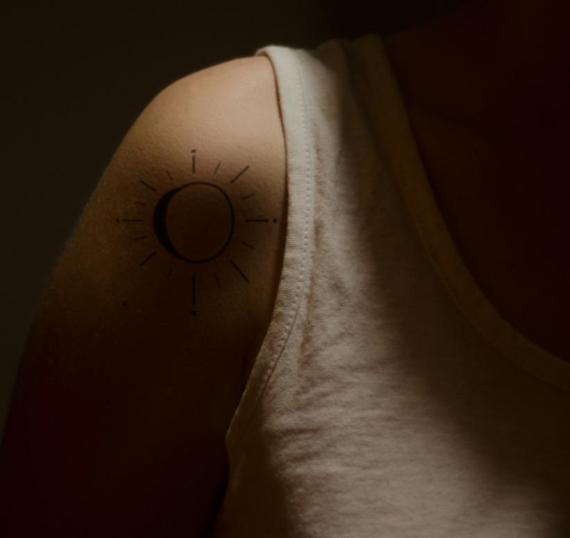
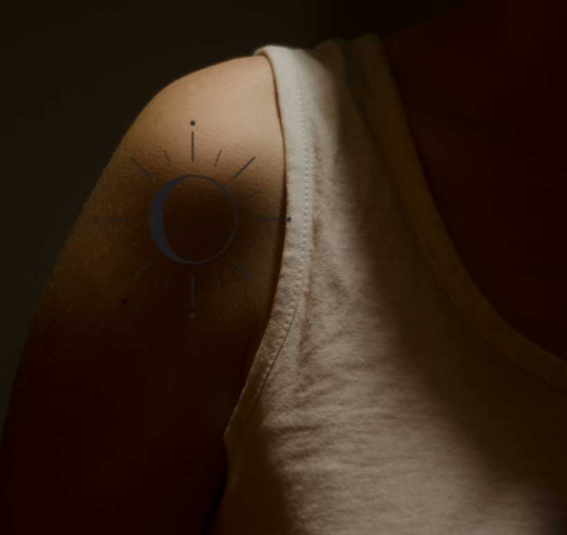
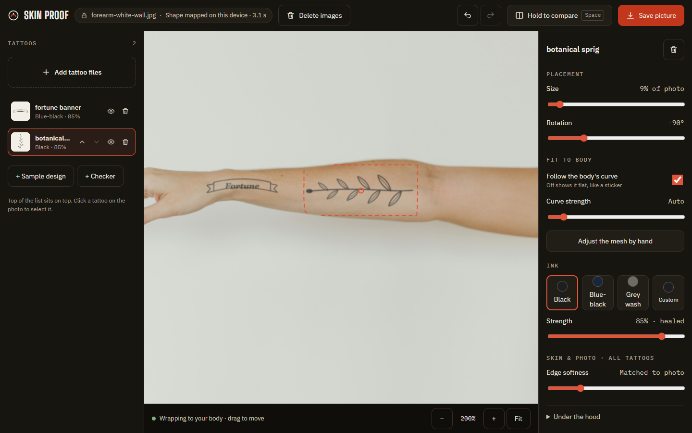
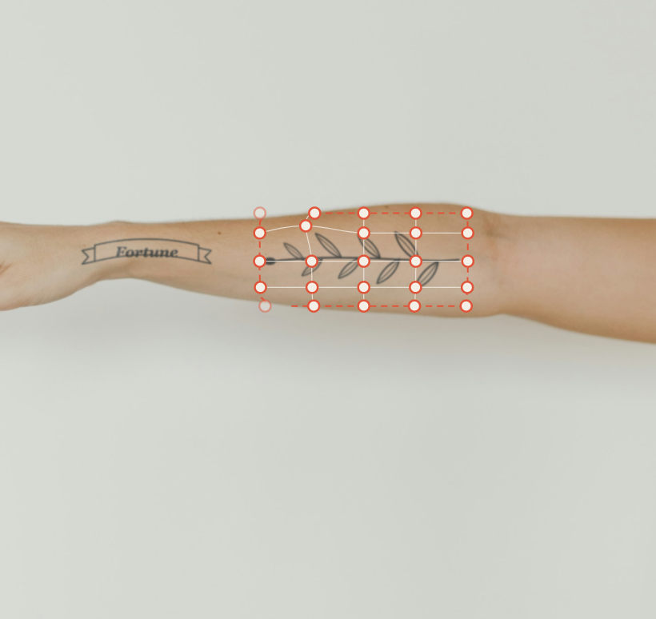
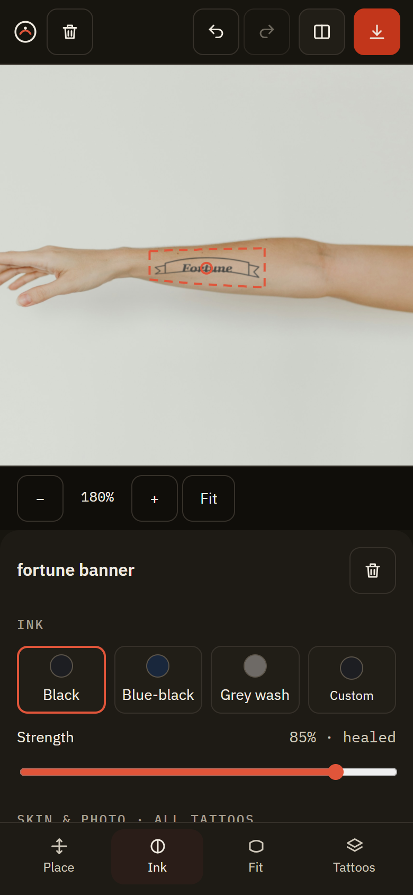

<div align="center">

# 🖋️ Skin Proof

**See the tattoo on your skin before the needle does.**

Upload a photo of your arm, drop in your design, and get a preview that wraps around your body
and sinks into your skin — all inside your browser. Your photo never goes anywhere.


### **[▶ Try it live: skin-proof.tattoo-viz.workers.dev](https://skin-proof.tattoo-viz.workers.dev)**



</div>

---

## Why though? 🤔

A tattoo is forever-ish. Mockups usually aren't: someone pastes a black PNG on a photo, it floats on
top like a sticker, and you learn nothing about how it'll actually sit on *your* arm.

Skin Proof tries hard to make the ink look like it's **in** the skin:

| Your photo | With Skin Proof |
|:--:|:--:|
|  |  |

Look at the bottom of the sun: the ink **darkens with the shadow** and the rays **curve away** with the
shoulder. That's the whole trick.

### Sticker vs. skin

| The usual way 😬 | Skin Proof 😎 |
|:--:|:--:|
|  |  |
| Flat, evenly grey, ignores the light. Reads as a sticker. | Wrapped to the body, shaded by it, with the skin's shine on top. |

---

## A tour of the studio 🎨



- **Drop in as many designs as you like.** Line art on white paper works best: a scan, a phone photo
  of a sketch, your artist's flash. The paper disappears and grey shading survives.
- **Drag, size, rotate.** Each tattoo wraps around the limb on its own, a few seconds after the photo
  loads, once your browser has worked out the shape of your body.
- **Pick your ink:** black, blue-black, grey wash or any colour, with strength from fresh to healed.
- **Hold Space** to flash the original photo. Before/after, instantly.
- **Save picture** exports a full-resolution PNG to show your artist (or your mum).
- **Undo, redo, delete.** One tattoo at a time, or wipe every image in one go.

### Didn't wrap quite right? Bend it. 🪄



Automatic fitting from a single photo is a best guess. **Adjust the mesh by hand** puts a 5×5 grid of
handles on the tattoo. Drag any dot and that spot follows your finger exactly while the area around it
bends smoothly. Your corrections stick to the design as you move, resize or rotate it, and
**Reset to the automatic fit** takes them all back.

### Works on your phone too 📱



---

## Your photo stays yours 🔒

Body photos are personal, so **nothing is uploaded. Ever.** There is no server to send them to.

- The body-shape model runs on your own graphics chip. Only the model's weights are downloaded, once.
- No account, no gallery, no history. Close the tab and it's gone.
- **Delete images** wipes your photo, every design and the undo history on the spot.
- Don't trust us? Open your browser's network panel while you work. No photo leaves.

---

## How it works (the nerdy bit) 🤓

```
photo ──► Depth Anything V2 (WebGPU, in a Web Worker) ──► relative depth
            │
            ├─► body mask + occlusion cuts (arm in front of torso ≠ one surface)
            ├─► relief scale calibrated to the limb under each tattoo
            ▼
design ──► arc-length layout on the surface (+ rim prior at the silhouette)
            ├─► your hand corrections (5×5 monotone-cubic lattice)
            ▼
WebGL2 compositor:  out = D · T + S
   D = diffuse skin light (filtered by the ink)   S = surface shine (passes over it)
   T = ink transmittance, Beer–Lambert, lifted by epidermal scatter (why healed black looks blue-black)
   + edge softness and grain matched to *your* photo's own sharpness and noise
```

A few things we measured rather than guessed:

- Ink darkness and blue shift match real healed tattoos in a test photo to within about **0.03** of
  skin brightness per channel.
- The wrap is tested against an exact cylinder and lands within **4 %** of the true curve.
- Edge softness is measured from each photo. A fixed blur made fine lines visibly too light.

---

## Run it yourself 🛠️

```bash
npm install
npm run dev          # http://localhost:5173
npm test             # geometry, lattice, noise and sharpness tests
npm run screenshots  # regenerate the images in this README (needs Chrome or Edge)
npm run deploy       # build and publish to Cloudflare (needs `npx wrangler login` once)
```

It's a static site: `npm run build` produces `dist/`, and `public/_headers` turns on cross-origin
isolation in production so the WebAssembly fallback can use threads. Any host that can set those two
headers works; this one runs on Cloudflare Workers static assets (`wrangler.jsonc`).

The engineering labs from the prototype (depth map viewer, compositing test bench, warp lab) live
at `/#/labs`.

<details>
<summary>Project layout</summary>

```
src/app/        landing page, studio UI, theme
src/studio/     useTryOn: the engine behind the studio (photo, depth, layers, undo, export)
src/depth/      Depth Anything V2 in a Web Worker
src/surface/    depth → surface: mask, occlusion cuts, calibration, rim prior
src/warp/       arc-length layout and the hand-correction lattice
src/render/     WebGL2 compositor, shaders, photo noise and sharpness estimation
src/design/     line-art keying
src/labs/       the engineering labs
scripts/        README screenshot generator
docs/           stock photos, demo designs and screenshots
```

</details>

---

## Honest about the limits 🙃

It's a preview from **one photo**, not a 3D scan. It's least accurate when:

- a design runs right around a limb, past what the camera can see;
- there's an existing tattoo under the new one (the shape model can mistake ink for bumps);
- the light is very harsh, or the background is busy;
- the photo is at an angle. Perspective and lens distortion aren't modelled.

It can't show how skin stretches when you move. Your artist still has the final say on size and
placement. 💪

---

## Credits 🙏

- Shoulder photo by [Viktor Talashuk](https://unsplash.com/photos/-kFU_JB9Xhc) and forearm photo by
  [Livia Rocha](https://unsplash.com/photos/H4STV63ICrs), both on Unsplash under the
  [Unsplash License](https://unsplash.com/license).
- Demo tattoo designs (`docs/stock/designs/`) were drawn for this project.
- Body shape from [Depth Anything V2 Small](https://huggingface.co/onnx-community/depth-anything-v2-small)
  (Apache-2.0) via [Transformers.js](https://github.com/huggingface/transformers.js).
- Type: Big Shoulders Display, IBM Plex Sans and Mono, Pinyon Script (Google Fonts).
